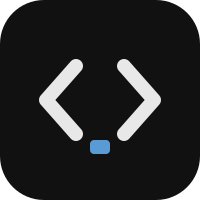
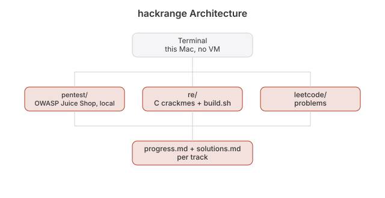

 

Learn to break in on your own machine. Two tracks: attack a deliberately broken web shop and crack small binaries. Everything runs on your Mac, with no VM and no Docker.

[hackrange.jaybulb.com](https://hackrange.jaybulb.com)


## Setup
- `brew install nmap gobuster`
- `clang`, `lldb` and `otool` ship with the Xcode command line tools
- `pentest/run-juiceshop.sh` clones Juice Shop on first run and needs Node

## Track 1 , Web pentest (OWASP Juice Shop)

Juice Shop is a deliberately vulnerable e-commerce app built by OWASP with 100+ intentional
bugs (XSS, SQLi, broken auth, IDOR, etc), each one a scored "challenge".

```
cd pentest
./run-juiceshop.sh        # starts at http://localhost:3000
```

It stays on 127.0.0.1: the script pins it to loopback, because upstream listens on your whole network and this app is broken on purpose. Then attack your own localhost. Track solved challenges by ticking them off in
`pentest/progress.md`. The in-app "Score Board" (visit `/#/score-board`) lists every
challenge and its difficulty , start there.

Useful tools once it's running:
- Browser devtools (Elements/Console/Network) , most XSS and IDOR bugs are found here first
- `gobuster dir -u http://localhost:3000 -w <wordlist>` , find hidden endpoints
- `nmap -sV localhost` , see what's actually listening

## Benchmark

Prove it works and time it: `python3 -I bench/bench.py`. It runs real solves against a local
Juice Shop and the crackmes, and scores each one against the app's own scoreboard so nothing is faked.
See [bench/README.md](bench/README.md).

## Track 2 , Reverse engineering (crackmes)

`re/crackmes/` has tiny C programs compiled without debug symbols. Each one hides a secret
(a password check, a license key check) you have to find by reading assembly, not source.

```
cd re
./build.sh                 # compiles every crackme in crackmes/ to bin/
lldb bin/crackme1           # step through it, set breakpoints, read registers
otool -tv bin/crackme1      # dump disassembly statically
```

Solve order is in `re/progress.md`. Don't peek at the `.c` source until you've solved it ,
that's the whole exercise. Solutions are in `re/solutions.md` (spoilers). Yes, the source is right there, and so are the answers. Reading them first only cheats you.

## Rules
Only attack Juice Shop on localhost, the crackmes in this repo, and platforms that invite it. Never point these
techniques at anything you don't own or don't have written permission to test. The full rules of engagement are in
[RULES.md](RULES.md). Read them first.

## Architecture


